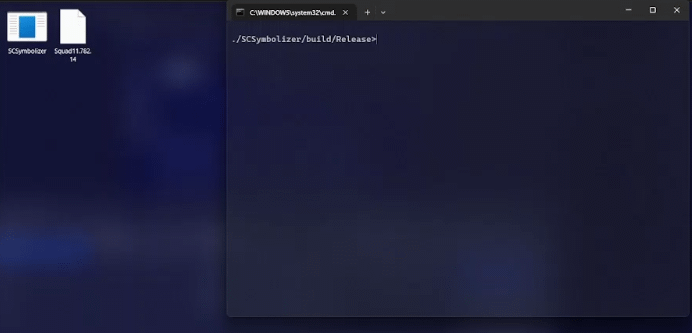

# SCSymbolizer
A tool made in C++ to export/import symbols from/to broken Mach-O files.



## Usage
```
./SCSymbolizer <action [export|import]> <file> [symbols file]
```

## Building
The tool should build on Windows, Linux and MacOS but I only guarantee Windows since the other enviroments weren't tested.

Debug:
```
cmake -S . -B build && cmake --build build
```
Release:
```
cmake -S . -B build -DCMAKE_BUILD_TYPE=Release && cmake --build build --config Release --parallel
```

## Some info
This tool is an upgraded version of [SupercellSymbolExtractor](https://github.com/xXCooBloyXx/SupercellSymbolExtractor) but made in C++ and with the abilitiy to import the symbols to the binary.

The purpose of this tool is to fix the [LeakDay](https://github.com/xXCooBloyXx/SupercellSymbolExtractor) vulnerable standalone Mach-O binaries.

## Credits
- CooBloy's [SupecellSymbolExtractor](https://github.com/xXCooBloyXx/SupercellSymbolExtractor)
- AI - Helping me understand some Mach-O stuff